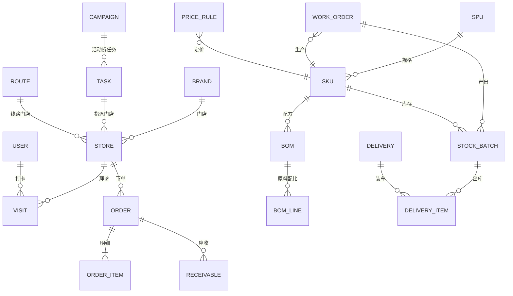

# 新平食品（宁波洪晟）调味品供应链协同系统 · 建设计划 v0.2

> 依据材料：① 郭老师提供的客户画像与需求文字；② 宁波洪晟食品《产品目录表新.xlsx》（74 个有品名的 SKU）；③ 群内两次确认的参与方与各自诉求 —— **连锁店商家（分布地图）、业务员（活动管理和绩效考核）、配送车队（配送路线规划、时效考核）、仓库（实时库存与原料补给）、生产车间（产能切换与排产）、老板（全面看板、实时利润与提升建议）**。
>
> 本文只做"对齐认知 + 划边界 + 排节奏"，不写代码。

---

## 0.1 现状（2026-11，自检后同步）

计划里 P0 已经做完，P1 的一部分已经跑起来了。对照第 8 节的表：

| 期 | 计划 | 现状 |
|---|---|---|
| P0 对齐 | 走访、原型、数据字典、商品清洗 | **已完成**（走访清单 33 项待填，其余已产出） |
| P1 跑通一单 | 主数据、下单、出入库、配送、看板 | **已完成并超出**：多加了登录权限、排产、门店/司机端、微信小程序 |
| P2 地推与考核 | 打卡、KPI、提成、时效考核 | **部分**：打卡与 KPI 有了；提成公式、时效考核还等 B09/B02 的答案 |
| P3 生产与进销存 | BOM、工单、质检、采购、成本 | **部分**：工单与排产有了；BOM/质检/采购/成本没有 |
| P4 深化 | 预测、路线优化、自助打样 | 未开始 |

**还没拿到答案的**（第 12 节）：B08 业务员人数与划区、B09 KPI 与提成公式、B02 配送时效、B21 是否多租户。
这四项不影响已经跑起来的部分，但决定了 P2/P3 剩下的怎么做。

---

## 0. 一句话结论

**这是一个"地推驱动的调味品产销一体"系统，不是三套独立软件。**

那条链是：**门店（订货/收货）→ 业务员（扫街/活动/代下单/提成）→ 订单中心 → 生产（排产/配方/批次）→ 仓库（库存/补给）→ 配送（路线/时效）→ 财务（应收/回款）→ 老板（利润/建议）**。

六个参与方各要一个东西，但它们**共用一套主数据和一条订单流**。所以做法是：先建底座、跑通一单，再让六个角色各自"长出自己那块屏幕"。并行开发三套再对接，是这类项目最常见的死法。

---

## 1. 我读到的业务

### 1.1 工厂画像

| 项 | 内容 |
|---|---|
| 主体 | 宁波洪晟食品有限公司（群内称"新平食品"，宁波市江北区慈城镇普济路 2 号 7 栋） |
| 产品 | 复合调味酱/汁/底料（不是单一调味料），目录 74 个 SKU、序号排到 100（真实 100+） |
| 规格 | 目录全为 **1kg/袋**；实际另有 **10g～1000g 小袋分装**，可灭菌、长保质期、适配流水线 |
| 能力 | 标准化酱料 + 定制配方 + 批量供货 + 按时交货 + 复合调味包/酱汁包 |
| 合规 | 客户对**标签、SC、防腐、包装、质检**要求高 —— 这既是护城河，也是系统必须承载的字段 |

### 1.2 客户与产品结构

目标客户是**连锁餐饮品牌**：火锅、麻辣烫、冒菜、黄焖鸡、烤鱼、小龙虾、面馆、螺蛳粉、快餐便当、外卖、拌饭、米线、预制菜。

客户为什么买：自己熬酱费人工、口味不稳定、食品安全难管控、没有工厂资质。

**品类骨架**（按目录表归纳，即商品主数据的第一版分类树）：

| 品类 | SKU 数 | 代表品 |
|---|---|---|
| 烤鱼系列 | 11 | 万州烤鱼酱、麻辣/香辣/椒麻/小米辣/蒜香/番茄/酱香/香辣孜然/酸辣金汤烤鱼酱、烤鱼高汤 |
| 火锅底料 | 6 | 老火锅/香辣/麻辣/番茄/藤椒/酸汤火锅底料 |
| 汤底·高汤 | 7 | 老母鸡底汤、浓缩牛骨汤底、红烧牛肉汤底、米线高汤、骨汤麻辣烫 |
| 小龙虾 | 4 | 香辣/麻辣/十三香/蒜蓉龙虾酱 |
| 凉拌·蘸料汁 | 5 | 蒸海鲜汁、酸辣/麻辣/五香凉拌汁 |
| 炒烧菜酱 | 14 | 干锅酱、香锅酱、把子肉酱、红烧肉酱、黄焖鸡酱、小炒酱、黑胡椒酱、沙茶酱、XO 酱 |
| 米线·麻辣烫·串串 | 8 | 麻辣烫底料、串串底料、青花椒底料、串串香红油、麻辣红油、老卤汁、番茄底料 |
| 烧烤·铁板 | 4 | 烧烤酱、叉烧烤、照烧汁 |
| 面点·小吃 | 5 | 酱香饼酱、手抓饼酱、煎饼酱、重庆小面酱、盖浇饭酱 |
| 煲类·特色 | 10 | 肉蟹煲（香辣/原味）、牛蛙酱、咖喱酱、香菇酱、黄金酸汤酱、秘制鱿鱼酱、泰式甜辣酱、油泼辣子 |

**目录表本身的问题**（第一笔要做的活）：
1. 只有 4 列（序号/品名/规格/备注），**没有价格、箱规、保质期、储存条件、SC、配料表、适用场景、是否定制**——它是"给客户看的型号清单"，不能直接当主数据。
2. 序号断号 21 个（13、39、40、44、45、46、48、50、53、58、59、60、63、67、69、74–77、79、86），尾部 95–100 只有号没名字 → 需工厂确认真实清单。
3. **重名**："酸辣凉拌汁"出现两次（2、24）。
4. 序号 71"火锅系列"是**混在数据行里的分组标题**（合并单元格），结构不规范。
5. 规格全是 1kg/袋 → 看不到 10g 小袋、5kg 桶、箱规，而这些在实际业务里一定存在。

### 1.3 现状 vs 痛点

| 环节 | 现在 | 痛点 |
|---|---|---|
| 找客户 | 业务员在天眼查/餐里眼查连锁品牌，在大众点评、饿了么、美团上找门店 | 名单在个人手机里，公司无沉淀；人走客户走 |
| 拜访 | 口头汇报 + 群里发照片 | 是否真到店、待多久、谈了什么，老板不知道；差旅油费无法核 |
| 下单 | 微信语音、电话、手写 | 规格听错、漏单、口头承诺价、对账扯皮 |
| 生产 | 老师傅按本子配料 | 定制配方版本混乱；批次追溯不了；**换口味清线靠经验，排产靠吼** |
| 库存 | Excel | 账实不符；效期不预警；**原料什么时候该补靠人记** |
| 配送 | 司机按记忆、微信派单 | 装错车、漏送、签收无凭证、**准时率算不出来** |
| 结算 | 月结翻微信 | 应收逾期、提成算不准、**单笔订单到底赚没赚不知道** |

---

## 2. 六方需求映射（需求边界，最硬的一页）

老板那句话已经把需求切成了六块屏。这一节就是**验收清单的源头**：

| 参与方 | 他要什么（原话） | 系统怎么落 | 关键指标 |
|---|---|---|---|
| **连锁店商家** | 分布地图 | 门店地图：按品牌/品类/区域聚合、热力、**覆盖盲区**、竞品门店标记；地图即作战图，框选即派任务 | 覆盖门店数、盲区数、单店月均用量 |
| **业务员** | 活动管理 + 绩效考核 | ① 打卡（GPS+围栏+照片+轨迹）② 拜访 6 步 ③ **任务与活动**：扫街战役、试菜会、限时促销，任务下发到人到店、进度可视 ④ KPI 与提成自动算 | 有效拜访、新增门店、试菜转化、首单额、回款、复购 |
| **配送车队** | 配送路线规划 + 时效考核 | 线路/配送日/装车单、司机端导航扫码签收、**准时率/在店时长/单车装载率/破损率** 考核 | 准时送达率、平均在店时长、装载率、异常单率 |
| **仓库** | 实时库存 + 原料补给 | 批次效期实时台账、库位、**安全库存与补货建议、缺料预警**、盘点 | 账实相符率、临期金额、缺料停线次数、周转天数 |
| **生产车间** | 产能切换 + 排产 | 产能日历（锅/灌装线/灭菌釜）、**同色同辣度聚类连做**、换线清洗矩阵（换口味要洗锅清线多久）、工单排产与报工 | 换线次数、设备利用率、按单交付率、单批损耗 |
| **老板** | 全面看板 + 实时利润 + 提升建议 | 经营看板（订单/发货/回款/毛利/人效/库存）+ **实时利润**（售价−标准成本−运费−提成）+ **规则建议**（见 4.7） | 毛利率、回款率、人均产出、现金占用 |

> 这张表决定了一件事：**利润要能算，成本就必须进系统**（原料、包材、运费、损耗）。所以 P3 的 BOM/成本不是"以后再说"，是老板那块屏的前置条件 —— 我在路线图里给了一个折中方案（第 8 节：先标准成本粗算，后实际成本精算）。

---

## 3. 端到端主流程

**任何一环断掉，系统就退回微信。** 所以第一版必须"端到端跑通一单"，而不是某模块做得极全。

---

## 4. 功能模块（7 块）

### M1 主数据与商品中心（底座，先做）

- **商品三段式**：品类 → SPU（万州烤鱼酱）→ **SKU（1kg 袋 / 500g 袋 / 10g×100 包 / 5kg 桶，含箱规）**。
- **SKU 编码**：`品类码(2)+流水(3)-规格码(2)-包装码(1)-版本(1)`，例 `KY001-1K-B-1`。
- **定制商品**：客户专属 SKU（`C{客户ID}-…`），与通用 SKU 分池，禁止串货串价。
- **配方/BOM**：原料 + 配比 + 工艺参数（灭菌温度/时间、灌装温度）+ **版本号**；流程 打样 → 寄样 → 客户封样 → 转正量产（每版留样、留检测报告）。
- **单位换算表**：袋/包/箱/件/托/吨（**全系统只存最小单位整数**，见 5.1）。
- **价格体系**：客户等级价、区域价、阶梯量价、促销价、含税/不含税、生效区间。
- **客户主数据**：品牌（总部）→ 门店（多地址多联系人），门店归属业务员/区域，账期 + 信用额度。
- 供应商、原料、包材、计量单位、库位、**产能资源（锅/灌装线/灭菌釜）**。

### M2 地推 CRM + 打卡 + 活动管理（管人）

- **商户池（公海）**：批量导入天眼查/餐里眼/点评/美团名单（Excel + **地图框选**），自动去重、按商圈/品类打标；公海→私海领用与回收。
- **门店分布地图**：品牌/品类/区域聚合、热力、**覆盖盲区**、竞品标记、按地图框选批量派任务。
- **打卡**：GPS + 门店围栏（默认 200m）+ 现场照（门头/菜单/后厨/货架）+ 停留时长 + 全轨迹。
- **拜访 6 步（固定流程，逼出结构化数据）**：到店打卡 → 认门店 → 记录（意向/竞品/月用量/决策人/价格敏感度）→ 试菜寄样 → 报价 → 首单/下次跟进。
- **活动管理**（老板要的"加大推广力度"）：
  - 任务型：扫街战役（框选 200 家门店，派给 5 个业务员，日进 40 家）
  - 活动型：试菜会、开业支持、限时进货折扣、搭赠
  - 活动预算/费用、参与门店、**活动 ROI**（投入 vs 新增首单额），复盘存档
- **绩效考核**：KPI 公式第一版就定死（拜访 20% + 新增 25% + 销售额 35% + 回款 20%，可配），提成按品类/毛利/新客阶梯，月末一键算薪。
- **防作弊**：虚拟定位识别、照片时间戳+EXIF、同店同日打卡合并、轨迹跳跃告警、换机登录告警。

### M3 订单中心

- **门店小程序**：常购清单、一键复购、按箱规选择、起订量、账期/在线支付、订单进度、对账单。
- **业务员代下单**（P1 主力入口，见 11.2）、内勤电话单。
- 报价/合同价挂客户，特价走审批；超信用额度拦截。
- 状态机：待确认 → 已确认 → 已排产 → 生产中 → 待发货 → 配送中 → 已签收 → 已回单（每步留人与时间）。
- 退换货、补货提醒（按门店历史用量预测 3/7 天缺口）。

### M4 生产管理（排产 + 轻 MES）

调味品车间的核心矛盾是**换线成本**，不是排程算法复杂度：
- **产能日历**：锅（如 500L 夹层锅 ≈ 400kg/锅）、灌装线、灭菌釜的班次占用；一个工单 = N 锅。
- **排产规则**：① 按交期倒排 ② **同香型/同辣度/同色系聚类连做**，减少洗锅清线 ③ 换线矩阵（跨品类清洗 30–60min，可配）④ 大批量连做优先，小单拼锅。
- 工单：按 BOM 倒推领料、缺料预警、配料称重记录（可接蓝牙秤）、灌装/灭菌/贴标/装箱报工、单批损耗。
- **批次号**：`生产日期+班次+产线+流水`；成品批次绑定原料批次 → 正反向追溯（哪批原料进了哪批成品、发给了哪些门店）。
- 质检：感官/理化/微生物（标准值 ± 公差）、留样、**未放行不得入库**。
- **标签合规**：模板化（品名、配料表、净含量、保质期、贮存、SC、致敏原、执行标准），按客户/规格套版，改版留痕。

### M5 进销存 / 仓储

- 四类库存：原料、包材、半成品、成品；库位、多仓（工厂仓 + 区域前置仓）。
- 单据：采购入库、生产领料、生产入库、销售出库、调拨、盘点、报损、退货入库。
- **批次 + 效期**：FEFO 近效期先出、临期 30/60/90 天预警、过期锁定。
- **原料补给**（仓库要的那块）：安全库存 + 在途 + 已占用（已排产未领料）三算净需求 → **自动采购建议单**；缺料直接反推影响哪几张工单（缺料停线预警）。
- 成本：移动加权平均 + 批次成本；库存台账日结。
- 呆滞：>60 天无动销 SKU、门店退单率。

### M6 配送 / TMS

- **线路 + 配送日**（三条主数据）：一辆车 20–40 家门店，按区域分日（周一城东、周二城西）；线路绑定门店与配送日。
- 波次拣货 → 装车单（扫码核对，防装错车）→ 出车；**单车装载率**看板。
- **司机小程序**：今日线路、一键导航、逐店扫码/拍照签收、代收货款、异常上报（拒收/少货/关门/破损）。
- **时效考核**：承诺时效（如 24h/48h）→ 准时送达率、**每店停留时长**、路线偏差率、破损率、回单及时率；按司机/线路/车辆出周报。
- 电子回单 = 门店签字（电子签或照片），回单即触发应收。
- 运费核算（按单/按重/包邮门槛）、车辆与温控记录（如有冷链）。

### M7 结算 + 老板看板

- **应收**：按门店/业务员/品牌出对账单，微信推送确认；回款核销（支持部分核销、预收冲抵）；逾期分级预警（7/15/30 天）。
- **利润**：单笔订单毛利 = 售价 − 标准成本（BOM 原料+包材）− 运费分摊 − 提成；按客户/SKU/业务员/品类四维下钻。
- **提成/业绩**：业务员、区域、品类毛利。
- **老板看板三层**：
  - 今日：订单数、发货额、在途、异常（缺料/逾期/超期配送）
  - 本月：销售额、毛利率、新增门店、回款率、库存周转、临期金额、现金占用
  - 人：业务员排名、拜访热力图、转化漏斗（线索→拜访→试菜→首单→复购）、活动 ROI
- **提升建议（规则引擎起步，先不做 AI）**：
  - "XX 品牌 3 家门店 45 天未复购，建议回访"（复购 gap）
  - "城西烤鱼品类动销最好，建议把下周扫街任务压到城西"（区域×品类）
  - "A 客户订单毛利率仅 8%，低于底线，建议调价或换规格"（毛利异常）
  - "酸辣凉拌汁临期 320 袋，建议打包给 B 类客户做搭赠"（临期+库存）
  - "麻辣烫底料 7 天净需求 1200 袋 > 现有产能，建议提前排产"（需求×产能）

---

## 5. 必须第一版就定死的 8 条规则

1. **单位换算**：全系统只存最小单位（袋/包）整数 + 一张换算系数表；报价按袋、订货按箱、库存按袋、财务按箱，展示层换算。禁止各页各自换算出小数。
2. **批次与效期**：入库必有批次与到期日，出库强制 FEFO。**没有批次的库存 = 不合格库存**。
3. **配方版本**：定制配方必须版本化，同一客户同一时间只有一个"生效版本"；改版必走打样→封样→客户确认；历史订单永远指向当时版本。
4. **价格**："客户×SKU"合同价 > 等级价 > 区域价；低于底价必须审批 + 留痕 + 进看板。
5. **账期与信用**：账期、信用额度、逾期锁单三件套一起上，否则应收失控。
6. **打卡有效性**：定位精度 > 100m 或停留 < 10min 或无现场照 → 记"无效拜访"，不计 KPI 不算差旅；规则提前公示并允许申诉。
7. **定制 SKU 隔离**：定制与通用商品不同编码段、不可混发，避免"给 A 的配方发给 B"。
8. **数据权限**：业务员只看自己门店与价格；配方字段对非研发角色脱敏（只显代号）；导出全留痕。

---

## 6. 数据模型（核心实体）

所有数量变动**只走库存流水**，禁止直接改余额（这是账实相符的唯一保障）。配套：组织/用户/角色/行级权限、单位换算、打卡记录、线索池、试菜打样单、质检单、采购单、产能资源与换线矩阵。

---

## 7. 技术方案

| 层 | 选型 | 理由 |
|---|---|---|
| 形态 | 1 套后端 + 4 个前端 | 管理端 Web、业务员小程序、门店小程序、司机小程序 |
| 后端 | NestJS 或 Spring Boot + PostgreSQL | **模块化单体**，不搞微服务；单机可部署 |
| 管理端 | Vue3 + Element Plus / React + AntD | 表格表单多，成熟组件省时间 |
| 移动端 | uni-app / Taro，一套代码出三个小程序 | 省一半工作量，微信生态直达 |
| 地图 | 高德/腾讯位置服务：逆地理、围栏、轨迹纠偏、路线规划 | 打卡、分布地图、配送共用一套 |
| 部署 | 云服务器 4C8G + 云数据库，**支持私有化** | ≈ ¥300–600/月 |
| 集成 | 微信/企微（通知、审批）、电子发票、可选金蝶/用友 | 按需，不早做 |

**工程上必须提前处理**：弱网离线打卡（本地缓存+补传）、虚拟定位识别、金额与数量用整数（分/袋）、批次追溯可反查、地图点位聚合（上千门店不卡）。

---

## 8. 分期路线图（14–17 周）

| 期 | 周 | 交付 | 验收标准（"跑通"的定义） |
|---|---|---|---|
| **P0 对齐** | 1–2 | 现场 1 天走访（仓库→车间→跟车→跟业务员）、原型、数据字典、商品目录清洗 | 六方各自认原型；74+ SKU 变标准主数据 |
| **P1 跑通一单** | 3–8 | 主数据 + 订单中心（代下单/复购）+ 成品出入库（批次效期）+ 配送单与司机签收 + 门店分布地图 + **轻打卡**（打卡/拍照/日志，不含 KPI）+ 看板 v1 | 连续 5 个工作日**全部订单走系统**，司机手机签收，仓库账实相符 |
| **P2 地推与考核** | 9–13 | 商户池、地图派任务、活动管理、拜访 6 步、KPI 与提成、防作弊、**配送时效考核**、**毛利粗算**（标准成本） | 业务员日报从系统出；KPI 与手工核对误差 < 2%；准时率可出周报 |
| **P3 生产与完整进销存** | 14–19 | 产能日历与排产、换线矩阵、BOM/配方版本、工单领料报工、质检放行、全链追溯、采购与原料补给、调拨盘点、**实际成本**、应收对账回款、**提升建议引擎** | 任取一袋成品可追溯到原料批次与发货门店；采购建议单可用；月结对账单自动生成 |
| **P4 深化** | 持续 | 补货预测、路线自动优化、客户自助选样/打样进度、BI、AI 建议 | 按使用数据排优先级 |

**排期原则**：P1 故意只做"成品出入库 + 批次效期"，不做 BOM 与成本——工厂最急的是**接单和送出去**；原料/配方/排产放 P3。老板要的"实时利润"在 P2 先用**标准成本**粗算（品类级毛利也足够指导决策），P3 再换实际成本精算。

> 若必须压缩：P0+P1 六周可上线，立刻替代微信接单。

---

## 9. 数据从哪来（决定项目能不能真用起来）

1. **商品目录**：74 个 SKU 清洗为"品类/SKU/规格/箱规/保质期/储存/SC/标签/建议价/适用场景"10 字段主数据（断号 21 个 + 重名 1 处需工厂确认）。
2. **客户与门店**：现有微信客户批量建档；存量订单 Excel 导入历史价与用量（首单报价有依据）。
3. **商户线索**：天眼查/企查查**官方 API** 合规接入；大众点评/美团/饿了么**无开放门店 API** —— 只做人工整理 + 地图框选导入，**不做爬虫**（合规与封号风险，也不稳定）。
4. **原料与配方**：P3 前从车间配料本、标签、检验报告录入，研发/车间主任确认。

---

## 10. 投入

| 项 | 估算 |
|---|---|
| 开发 | 1 后端 + 1 前端/小程序 + 0.5 产品实施，14–17 周 |
| 云资源 | 服务器 + 库 + 对象存储 ≈ ¥300–600/月 |
| 三方服务 | 地图 API（免费额度常够）、短信/模板消息 ≈ ¥100/月、企查查 API 按量 |
| 硬件（可选） | 蓝牙电子秤（配料）、标签打印机、手持 PDA（仓库/司机） |
| 隐性成本 | 现场实施培训 3–5 天、数据初始化 3–5 天、习惯迁移 2–4 周（**最大风险**） |

---

## 11. 风险与对策

| # | 风险 | 对策 |
|---|---|---|
| 1 | **业务员抵触打卡**（觉得被监控） | 打卡绑提成/差旅；先给老板看"过程"，KPI 后置；规则公示 + 申诉通道 |
| 2 | 门店不愿用小程序（小店老板年龄大） | P1 以**业务员代下单**为主入口，门店端只做"看常购+一键复购+对账" |
| 3 | 数据脏、初始化拖延 | P0 完成商品目录清洗，只给"填"不给"造"的模板 |
| 4 | 定制配方外泄 | 字段脱敏 + 角色隔离 + 导出留痕 + 版本封样 |
| 5 | 弱网/定位漂移 | 离线补传、精度阈值、"补录+事后审核"通道 |
| 6 | 范围蔓延（"全都做"） | 8 周 MVP 卡死范围，其余进 backlog 周评审 |
| 7 | 排产规则没沉淀（全靠老师傅） | P0 就把"换线矩阵、锅次、班次"问出来变成配置，不做通用算法 |
| 8 | 单点依赖 | 规则配置化、不写死；交付含手册与录屏 |

---

## 12. 需要你确认的 8 件事

1. **配送**：自营车队几台车？有无冷链/温控？**承诺时效是 24h 还是 48h**（决定时效考核口径）？
2. **下单主入口**：门店自下单 vs 业务员代下单为主？多少家活跃门店、常用 SKU 多少？
3. **定制占比**：多少客户定制配方？一个定制客户平均几个专属 SKU？
4. **生产**：主要设备（锅容量、灌装线、灭菌釜）、班次、**换线清洗时间**、有没有现成排产习惯（按订单还是按备货）？
5. **仓储**：几个仓？原料/包材/成品是否同库？现在盘点频率？
6. **销售组织**：业务员几人？怎么划区域、怎么算提成？KPI 现在怎么算？
7. **已有系统**：有没有用友/金蝶/财务软件？要不要对接（可省 2–3 周）？
8. **交付形态**：工厂自用（私有部署），还是以后想卖给同行（多租户 SaaS）？

---

## 13. 本周可直接产出

1. **《商品主数据表》**：74 个 SKU 清洗归类 + 10 字段空白模板（工厂只填箱规/保质期/价格）。
2. **可点击原型**：门店下单、业务员打卡+地图派任务、司机签收、老板看板 4 屏。
3. **数据字典与字段口径**（开发用 + 工厂确认用）。
4. **P1 需求说明书**（按第 8 节验收标准逐条写）。

---

*v0.2 · 补齐六方需求映射（分布地图/活动管理/时效考核/原料补给/产能切换与排产/实时利润）。第 12 节确认后升 v1.0 并输出 P1 需求说明书与原型。*
